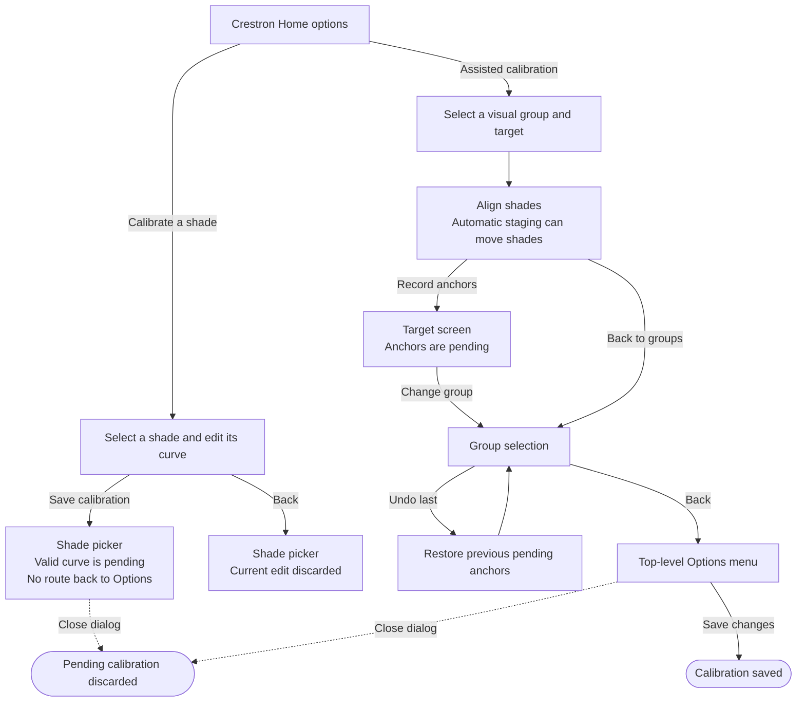

# Options flow overview

In Home Assistant, open **Settings → Devices & services → Crestron Home** and
select **Configure** on the integration entry. **Save changes** on the top-level
Options menu is the step that persists pending calibration. Closing the dialog
before that step discards pending calibration. Automatic staging can move shades
before any calibration is saved.

## Combined diagram

## Per-shade editor flow

1. Choose **Calibrate a shade**, select a shade, and choose **Continue**.
2. Adjust the anchors or the shade's **Invert axis** setting. Keep the 0% and
   100% endpoints. Percentages must increase, and raw positions may stay the
   same or increase.
3. Choose **Save calibration** and select **Apply**. A valid curve becomes
   pending, and the form returns to **Select a shade**. To discard the current
   edit, choose **Back** and select **Apply**. This also returns to the shade
   picker and leaves any earlier pending edits intact.

The shade picker currently has no route back to the top-level Options menu.
Manual calibration stays pending, and closing the dialog discards it. See the
[manual calibration save issue](https://github.com/sharwell/ha-crestron-home/issues/51).

## Assisted calibration flow

1. Choose **Assisted calibration**, select a visual group with at least one
   shade, then choose **Start** and select **Continue**.
2. Accept the suggested midpoint of the largest remaining gap or enter your own
   target percentage. **Automatic** stages a move when you continue. Choose
   **From current location** to work with the current positions without sending
   a staging move.
3. On the alignment screen, align the shades as needed, choose **Record
   anchors**, and select **Continue**. The integration adds new or revised
   anchors to the pending calibration. It skips unchanged anchors and shades
   without a reported position.
4. After recording, the flow returns to the target screen. Choose **Change
   group** to return to group selection. From the alignment screen, **Back to
   groups** returns without recording that attempt and keeps earlier pending
   changes.
5. On group selection, choose **Undo last** to reverse the most recent
   recording if it changed anchors. This restores the previous pending
   calibration. To finish, choose **Back** on group selection and then
   **Save changes** on the top-level Options menu.
